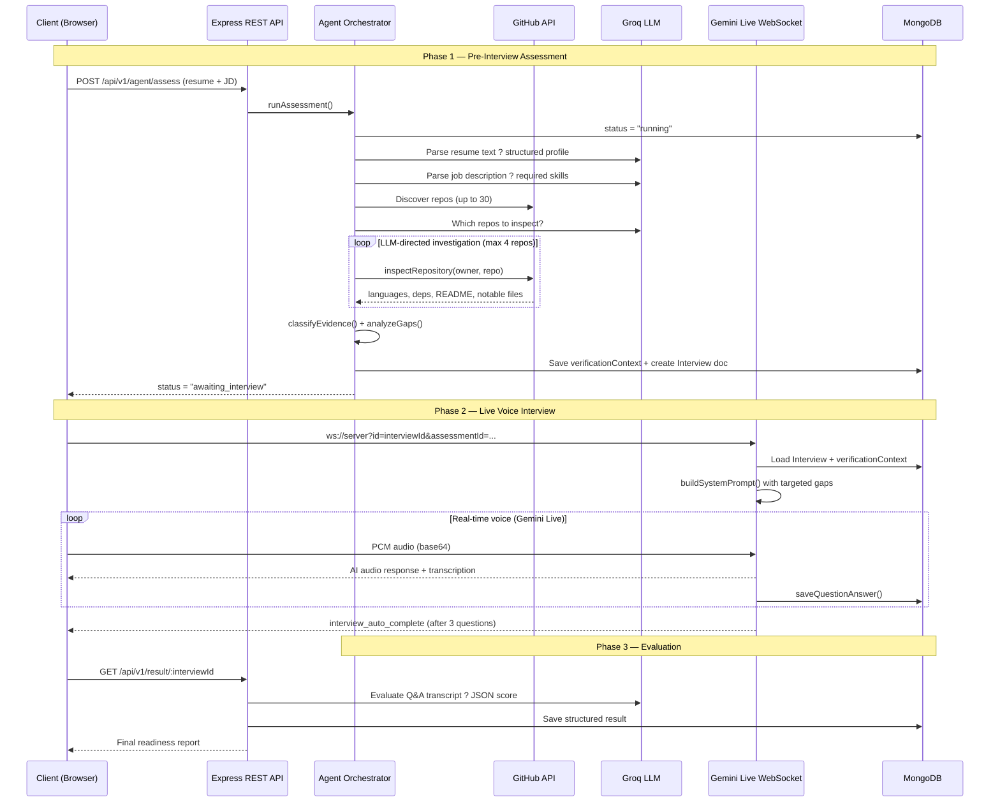

# MockHire — AI-Powered Resume Verification & Interview Platform

>  · Theme: Best Use of Google Gemini API · Built with Gemini Live API + Groq LLM

MockHire is an intelligent hiring assistant that **verifies candidate resumes against real GitHub evidence** and conducts a live AI voice interview powered by **Google Gemini Live API**. Instead of trusting keyword-stuffed resumes, MockHire autonomously investigates a candidate's actual code repositories, identifies skill gaps, then conducts a targeted, adaptive voice interview — all in real time.

---

## ? Key Features

| Feature | Description |
|---|---|
| ?? **Resume Verification Agent** | Autonomous multi-stage agent that parses resumes, discovers GitHub repos, and classifies evidence for every claimed skill |
| ??? **Gemini Live Voice Interview** | Real-time bidirectional audio via WebSockets; Gemini Live API drives adaptive questioning based on the candidate's actual evidence |
| ?? **Adaptive Verification Loop** | When gaps are found, a dedicated 3-question verification interview probes exactly the flagged skills |
| ?? **ATS Score Checker** | Guest-accessible tool to check resume–JD match percentage with matched/missing keywords |
| ?? **AI Evaluation Report** | Post-interview LLM evaluation with per-question scores, a readiness score, and a structured hiring report |
| ?? **Auth via Clerk** | Seamless sign-in/sign-up; protected routes for dashboard, setup, and interview pages |

---

## ??? System Architecture

```
Frontend (React + Vite)
      ¦
      ¦  HTTP (REST)          WebSocket
      ?                           ?
Assessment API -------- Gemini Live WS Server
      ¦                           ¦
      ?                           ?
Agent Orchestrator           InterviewState
  +- PREREQUISITES              +- saveQuestionAnswer()
  ¦    +- Parse Resume (LLM)
  ¦    +- Parse Job Description
  ¦    +- Discover GitHub Repos
  +- INVESTIGATE (LLM-directed)
  ¦    +- inspectRepository() × up to 4 repos
  +- PREPARE_INTERVIEW
  ¦    +- Build verificationContext ? MongoDB
  +- AWAITING_INTERVIEW  ? Gemini Live takes over here
  +- EVALUATE_AND_REPORT
       +- Score + Generate Hiring Report
```

### Sequence Diagram



---

## ??? Tech Stack

### Backend (`/Server`)
| Technology | Purpose |
|---|---|
| Node.js + Express | REST API server |
| `ws` (WebSockets) | Gemini Live audio bridge |
| MongoDB + Mongoose | Persistent state & transcripts |
| `@google/genai` | Gemini Live API (voice interview) |
| `groq-sdk` | LLM for resume/JD parsing, evaluation |
| `@clerk/express` | JWT auth middleware |
| `multer` | Resume file upload (PDF/DOCX) |
| `pdf-parse` + `mammoth` | Resume text extraction |
| `axios` | GitHub API calls |
| `express-rate-limit` | API abuse protection |

### Frontend (`/Client`)
| Technology | Purpose |
|---|---|
| React 19 + TypeScript + Vite | UI framework |
| Tailwind CSS v4 + Shadcn UI | Styling & components |
| Framer Motion | Animations & page transitions |
| `@clerk/clerk-react` | Frontend auth |
| React Query + Axios | Server state & data fetching |
| React Router v7 | Client-side routing |
| Sonner | Toast notifications |

---

## ?? Getting Started

### Prerequisites
- Node.js v18+
- A MongoDB Atlas connection string (or local MongoDB)
- API keys — see [Environment Variables](#-environment-variables)

### 1. Clone the Repository
```bash
git clone <repository-url>
cd Ai_Interview
```

### 2. Server Setup
```bash
cd Server
npm install
# Create .env and fill in your keys (see Environment Variables section)
npm run dev   # starts on http://localhost:8080
```

### 3. Client Setup
```bash
cd ../Client
npm install
# Create .env and fill in your Vite keys
npm run dev   # starts on http://localhost:5173
```

---

## ?? Environment Variables

### Server (`/Server/.env`)
```env
PORT=8080
MONGO_URL=mongodb+srv://<user>:<password>@<cluster>/interview
GEMINI_API_KEY=<your-google-gemini-api-key>
GROK_API_KEY=<your-groq-api-key>
RESULT_GROK_API_KEY=<your-groq-api-key>   # can be same as GROK_API_KEY
GITHUB_TOKEN=<optional-github-pat>        # raises rate limit from 60 to 5000 req/hr
CLERK_PUBLISHABLE_KEY=pk_test_...
CLERK_SECRET_KEY=sk_test_...
CLERK_TELEMETRY_DISABLED=1
```

### Client (`/Client/.env`)
```env
VITE_CLERK_PUBLISHABLE_KEY=pk_test_...
VITE_API_URL=http://localhost:8080/api/v1
VITE_WS_URL=ws://localhost:8080/ws
```

---

## ?? API Reference

### ATS Checker (Guest accessible)
| Method | Endpoint | Description |
|---|---|---|
| `POST` | `/api/v1/ats/analyze` | Upload resume + JD, returns ATS match score |
| `GET` | `/api/v1/ats/me` | Get ATS check history (auth required) |

### Interview Flow (Auth required)
| Method | Endpoint | Description |
|---|---|---|
| `POST` | `/api/v1/pre-interview` | Upload resume, create interview session |
| `GET` | `/api/v1/interviews/me` | List all interviews for current user |
| `GET` | `/api/v1/interview/:id` | Get interview details |
| `GET` | `/api/v1/result/:id` | Trigger/fetch AI evaluation for completed interview |

### Assessment Agent (Auth required)
| Method | Endpoint | Description |
|---|---|---|
| `POST` | `/api/v1/agent/assess` | Start full agent assessment (resume + JD upload) |
| `GET` | `/api/v1/agent/assess/me` | List all assessments for current user |
| `GET` | `/api/v1/agent/assess/:assessmentId` | Get assessment status & results |
| `POST` | `/api/v1/agent/assess/:assessmentId/interview-complete` | Signal interview done, triggers evaluation |

### WebSocket
```
ws://localhost:8080/ws?id=<interviewId>
ws://localhost:8080/ws?id=<interviewId>&assessmentId=<assessmentId>   <- verification mode
```

---

## ??? Frontend Routes

| Route | Access | Description |
|---|---|---|
| `/` | Public | Landing page |
| `/ats` | Public | ATS score checker |
| `/contact` | Public | Contact page |
| `/dashboard` | Auth | Interview history & stats |
| `/setup` | Auth | Create mock interview (Phase 1 flow) |
| `/interview/:id` | Auth | Live Gemini voice interview |
| `/result/:id` | Auth | Post-interview AI evaluation |
| `/assessment/setup` | Auth | Full agent assessment setup |
| `/assessment/:id/progress` | Auth | Real-time agent progress tracker |
| `/assessment/:id/result` | Auth | Detailed assessment report |

---

## ?? Running Tests

### Backend (Playwright E2E)
```bash
cd Server
npx playwright test
```

### Unit Tests (Orchestrator logic)
```bash
cd Server
node src/agent/orchestrator.test.js
```

---

## ?? How GitHub Verification Works

1. **Discover** — fetches up to 30 repos (language, topics, stars, updated_at)
2. **Investigate** — Groq LLM decides which repos (max 4) are worth deep inspection
3. **Inspect** — for each chosen repo, the system fetches:
   - Language breakdown (byte counts per language)
   - Root file list + notable infra files (Dockerfile, nginx.conf, etc.)
   - `package.json` / `requirements.txt` dependency lists
   - First 1,500 chars of README
4. **Classify** — deterministic evidence scoring maps repo evidence ? candidate claims
5. **Gap Analysis** — compares job requirements vs verified skills ? generates `verificationContext`
6. **Targeted Interview** — Gemini Live receives specific probes for unverified claims

---

## ??? Gemini Live Integration Details

The voice interview is powered by the **Gemini Live API** via a persistent WebSocket connection.

- **Audio format:** PCM 16-bit, 16 kHz, mono (streamed as base64)
- **System prompt** is dynamically built from:
  - Candidate's resume summary
  - Job context (title, type, difficulty, experience level)
  - `verificationContext` — targeted claims and gaps (verification mode only)
- **Turn management:** Async message queue serialises AI events; late transcription chunks are correctly attributed to past Q&A pairs
- **Auto-complete:** After 3 verification questions, server sends `interview_auto_complete` and triggers orchestrator evaluation

---

## ?? Known Issues & Limitations

- **GitHub rate limit:** Without a `GITHUB_TOKEN`, the API allows only 60 requests/hour. Set the env var to raise the limit to 5,000/hour.
- **Verification interview cap:** Fixed at 3 questions (configurable via `MAX_VERIFICATION_QUESTIONS` in `Server/src/websocket/interviewSocket.js`).
- **ATS checker:** Accessible to guests via anonymous session cookie.

---

## ?? Project Structure

```
Ai_Interview/
+-- Client/                  # React + Vite frontend
¦   +-- src/
¦       +-- api/             # Axios client wrappers
¦       +-- components/      # Reusable UI components
¦       +-- context/         # Theme context
¦       +-- hooks/           # React Query hooks
¦       +-- page/            # Route-level page components
¦       +-- Services/        # MediaHandler (audio streaming)
¦       +-- types/           # TypeScript types
¦
+-- Server/                  # Node.js + Express backend
    +-- src/
        +-- agent/           # Orchestrator + state machine
        ¦   +-- orchestrator.js   # Core assessment lifecycle
        ¦   +-- state.js          # Immutable state + checkpointing
        +-- controller/      # Route handlers
        +-- middleware/      # Auth, rate limiting, anonymous sessions
        +-- model/           # Mongoose schemas
        +-- routes/          # Express routers
        +-- services/        # GitHub, Gemini Live, resume parsing, ATS
        +-- websocket/       # Gemini Live WebSocket bridge
```

---

## ?? License

MIT — feel free to use, modify, and distribute.
