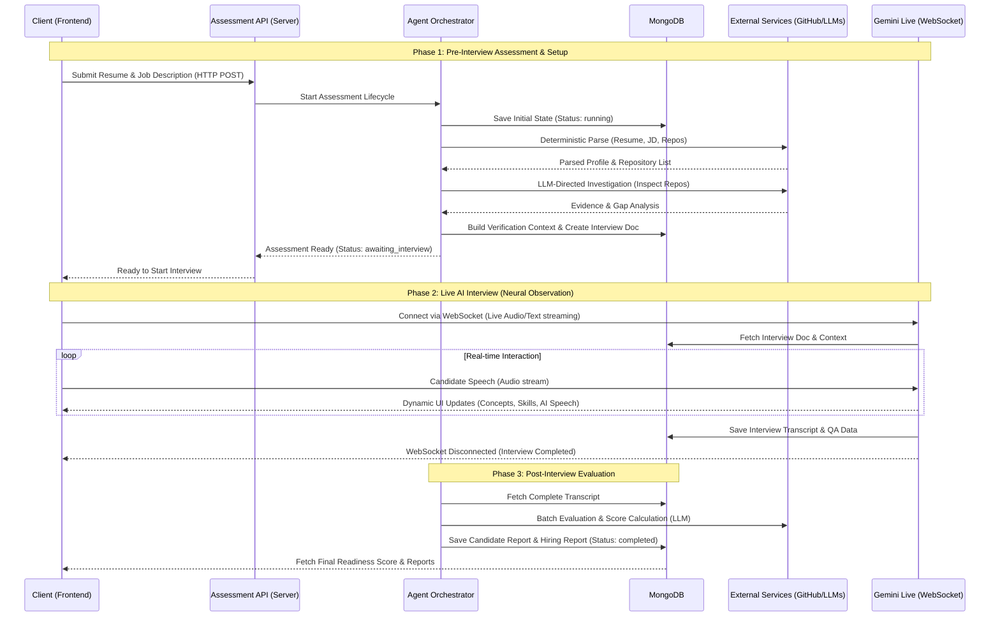

# MockHire

MockHire is an experimental AI system that acts as an intelligent observer during a candidate's interview. It is not a traditional chatbot or interview form—it is a "neural observation" interface designed to make the AI's evaluation process visible, feeling like an advanced research instrument rather than a generic SaaS application.

The platform provides a cinematic, spatial experience that dynamically displays:
- **Human Input:** The candidate's spoken responses.
- **Thought Structure:** Concepts and logic extracted from the answers.
- **Machine Observation:** Real-time AI evaluation metrics and detected skills.

## Use Cases

MockHire serves as a dual-purpose platform, providing immense value to both hiring teams (HR) and candidates:

### For HR & Recruiters
- **Bulk Processing:** HR can dump candidate applications (resumes and job descriptions) into the system for autonomous pre-screening.
- **Automated Verification:** The engine independently verifies a candidate's claims by inspecting their GitHub repositories, looking for concrete proof of their skills before the interview even starts.
- **Data-Driven Hiring:** Provides a comprehensive "Readiness Score" and detailed hiring reports, saving hours of manual resume review and technical screening.

### For Candidates
- **Direct Interaction:** The system can be exposed as a public-facing interface where candidates directly interact with the AI to take their assessments.
- **Fair Evaluation:** Candidates get a chance to verbally and technically prove the skills on their resume during the live AI interview, ensuring they are evaluated on actual knowledge rather than just keywords.
- **Unique Experience:** Offers a cinematic, engaging interview environment where candidates can see the AI understanding their thoughts and logic in real-time.

## System Workflow & Architecture

To help recruiters and technical evaluators understand how MockHire functions under the hood, here is the lifecycle from resume submission to the final readiness report. It highlights the integration between standard REST APIs and the real-time WebSocket connection used during the live interview.



## Features

- **Live Speech-to-Text & Analysis:** Converts user speech into structured concepts dynamically.
- **"The Core" Interface:** A living visual representation of the active intelligence (Idle, Listening, Processing, Speaking).
- **Cinematic Flow:** Smooth, spatial transitions between questions rather than sudden swaps.
- **Non-Chatbot Interaction:** Answers form flowing documents; observations appear as instrumentation.

## Tech Stack

### Client (Frontend)
- **Framework:** React 19 + TypeScript + Vite
- **Styling:** Tailwind CSS + Shadcn UI
- **Animations:** Framer Motion
- **Authentication:** Clerk
- **State/Fetching:** React Query + Axios
- **Real-time:** WebSockets

### Server (Backend)
- **Framework:** Node.js + Express
- **Database:** MongoDB (Mongoose)
- **AI Integrations:** Google GenAI, Groq SDK
- **File Parsing:** Multer, pdf-parse, mammoth
- **Real-time:** WebSockets

## Getting Started

### Prerequisites
- Node.js
- MongoDB instance
- Clerk API Keys
- Gemini / Groq API Keys

### Installation

1. **Clone the repository:**
   ```bash
   git clone <repository-url>
   ```

2. **Setup the Server:**
   ```bash
   cd Server
   npm install
   # Create a .env file and add your environment variables (MongoDB URI, API Keys, etc.)
   npm run dev
   ```

3. **Setup the Client:**
   ```bash
   cd ../Client
   npm install
   # Create a .env file with your Vite Clerk keys, API URLs, etc.
   npm run dev
   ```

## Architecture & Design Guidelines

For a deep dive into the system design, UI philosophy, and AI integration boundaries, refer to:
- [`design.md`](./design.md) - UI philosophy and visual direction.
- [`architecture.md`](./architecture.md) - System architecture and component reuse.